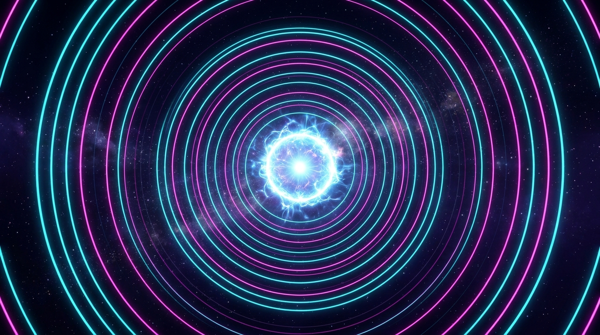

# Harmonix 🌌

> Hypnotic, ultra-sharp vector resonance visualizer with high-DPI rendering, harmonic ripples, and interactive generative physics.

Harmonix is a real-time generative audio-visual experience built with pure Vanilla JavaScript and HTML5 Canvas. It features sub-pixel anti-aliased concentric wave physics, dynamic 3D perspective gimbal rings, cymatic acoustic interference patterns, and toggleable ambient pentatonic crystal chimes.

🔗 **Experience it Live**: [https://mahesh-yennam.github.io/Harmonix/](https://mahesh-yennam.github.io/Harmonix/)

---

## ✨ Features

- **Crystal-Clear Vector Rendering**: Built directly on a native high-DPI Canvas engine (`devicePixelRatio` scaling) for razor-sharp vector arcs without blur, texture scaling, or pixelation on 1080p, 4K, and Retina screens.
- **4 Harmonic Animation Modes**:
  - **Harmonic Pulse**: Continuous, silky-smooth concentric ripples expanding outward with orbiting micro-satellites.
  - **Cymatic Waves**: Dual-focus acoustic interference pattern that dynamically warps with mouse and touch movement.
  - **Orbital Gyro**: Multi-axial 3D tilted celestial gimbal loops with orbiting jewel beads.
  - **Spirograph**: Sacred geometric rosettes that rhythmically breathe and morph in real-time.
- **5 Curated Color Spectrums**:
  - ⚡ **Cyber Neon**: Electric Cyan (`#00f5d4`), Deep Violet (`#7b2cbf`), and Hot Pink (`#f72585`).
  - 🌿 **Aurora**: Mint Emerald (`#00ff87`), Sky Ice (`#60efff`), and Deep Ocean Blue (`#0061ff`).
  - ☀️ **Solar Gold**: Radiant Amber (`#ffd000`), Sunburst Orange (`#ff4b00`), and Crimson Rose (`#ff0055`).
  - 🔮 **Amethyst**: Soft Lavender (`#e0aaff`), Vibrant Violet (`#9d4edd`), and Deep Indigo (`#3a0ca3`).
  - ❄️ **Electric Glacial**: Pure Glacial Cyan (`#00d2ff`), Azure (`#3a86ff`), and Star White (`#f0f8ff`).
- **Interactive Ripple Shockwaves**: Tap or click anywhere on the canvas to radiate luminous expanding shockwave ripples.
- **Ambient Pentatonic Synthesizer**: Generates soft, crystal sine-wave chimes using the Web Audio API on shockwaves and harmonic peaks (toggleable, muted by default).
- **Mobile-First & Touch Optimized**: Native bottom-sheet drawer for touchscreens, gesture safe-area insets, and zero rubber-banding.
- **Zero Runtime Dependencies**: 100% lightweight Vanilla JavaScript, HTML5 Canvas, and modern CSS3.

---

## 🎮 Controls & Shortcuts

| Action | Shortcut / Input | Description |
| :--- | :--- | :--- |
| **Pause / Resume** | <kbd>Space</kbd> or HUD button | Freezes or unfreezes time and wave progression |
| **Shockwave** | <kbd>Click</kbd> / <kbd>Tap</kbd> | Emits an expanding luminous shockwave ring |
| **Hide / Show HUD** | <kbd>H</kbd> or X button | Toggles the glassmorphism control panel for a clean screensaver view |
| **Fullscreen** | <kbd>F</kbd> | Toggles full-screen immersive mode |
| **Ring Density** | Slider (6–36) | Controls how many concentric rings are actively generated |
| **Wave Speed** | Slider (0.2x–2.5x) | Adjusts the expansion velocity and rotation speed |
| **Line Sharpness** | Slider (1.0px–5.0px) | Customizes vector stroke thickness |
| **Sound Toggle** | Audio Button | Enables or disables ambient crystal chimes |

---

## 📱 Mobile Experience

- **Native Bottom Sheet**: Controls collapse into a smooth drawer at the bottom of the screen with a pull-down handle and touch backdrop dismiss.
- **Safe-Area Insets**: Adapts automatically to modern phone notches, camera cutouts, and bottom navigation indicators.
- **Touch Targets**: Ergonomic 42px touch-friendly chip buttons and 22px slider thumbs.

---

## 🛠️ Tech Stack

- **Structure**: HTML5 Semantic markup & PWA Web Manifest
- **Styling**: Vanilla CSS3 (Custom Properties, Glassmorphism, Responsive Media Queries)
- **Engine**: HTML5 Canvas 2D with High-DPI sub-pixel anti-aliasing
- **Audio**: Web Audio API (Synthesizer Oscillators & Gain Envelopes)
- **Typography**: Google Fonts ([Outfit](https://fonts.google.com/specimen/Outfit))

---

## 🚀 Running Locally

No build tools or package managers required. Simply open `index.html` in any modern web browser:

1. Double-click `index.html` or drag it into Chrome, Edge, Safari, or Firefox.
2. Alternatively, serve the folder with any static local server (e.g. VS Code Live Server, Python `python -m http.server`, or Node `npx serve`).

---

## 📄 License

MIT License. Free to use, modify, and distribute for personal and commercial projects.
